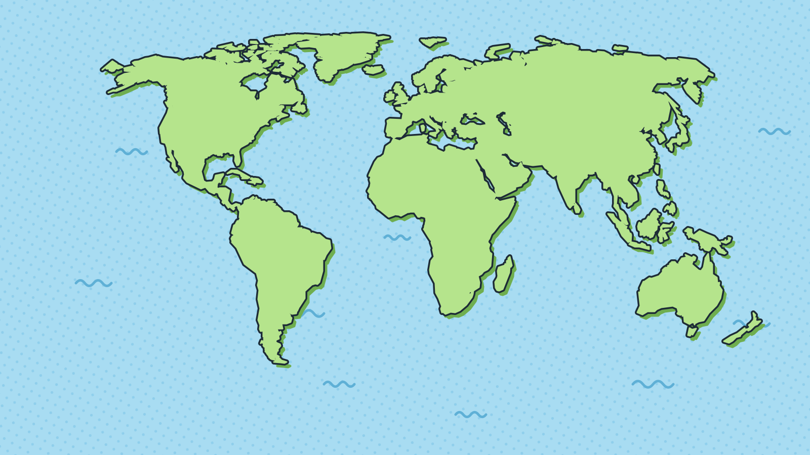
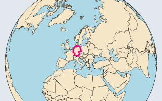
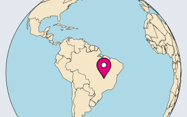
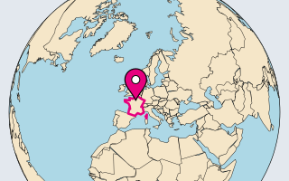
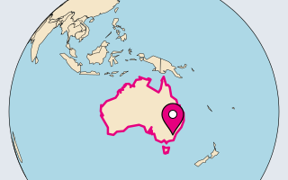
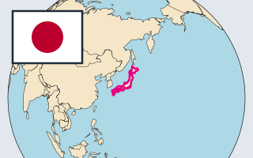
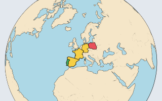

  

<h1 align="center">🌍 Country Guesser 🌍</h1>

<b>Spin the globe. Name the world. Paint it green!</b> 
A comic-style quiz for every country on Earth. The globe shows how well you know each one.

  

<h3 align="center"><a href="https://josezehentner.github.io/country-guesser/">👉 josezehentner.github.io/country-guesser 👈</a></h3>

Free · no sign-up · in the browser on computer or phone · in German for now, more languages planned

## 🎮 Six ways to play

| | | |
|:---:|:---:|:---:|
|  **"Länder benennen"** Name the countries |  **"Länder finden"** Find the countries |  **"Hauptstädte lernen"** Learn the capitals |
|  **"Hauptstädte finden"** Find the capitals |  **"Flaggen erkennen"** Recognize the flags |  **"Grenzgänger"** Cross borders |

**✍️ Type it** (names, capitals, flags): one Enter is enough. Right? The next one comes by itself. Wrong? See the answer, move on when ready. Spelling is forgiving: case, missing umlauts ("Osterreich") and small typos are fine, and other common names count ("USA", "Amerika", "UK", "Côte d'Ivoire").

**👆 Click it** (find countries, find capitals): a click just next to a tiny country is enough. Wrong? The globe turns to the right one; click again to move on.

- 🗺️ **"Länder benennen":** a country is marked; type its name.
- 📍 **"Länder finden":** the game names a country; click it.
- 🏛️ **"Hauptstädte lernen":** a country is marked; type its capital. The answer also shows the country. German, English and local names count ("Peking", "Beijing"), and every capital of a country with several, such as Bolivia (Sucre, La Paz) or South Africa. Uninhabited places like Antarctica are left out.
- 🎯 **"Hauptstädte finden":** the game names a capital, such as Canberra; click its country. Shared names like Kingston (Jamaica, Norfolk Island) accept either.
- 🚩 **"Flaggen erkennen":** a flag appears; type its country, and the globe turns there. Look-alikes Monaco/Indonesia and Romania/Chad accept either name. Places flying another country's flag (Réunion) and Antarctica are left out.

### 🧭 "Grenzgänger"

Get from start to end, say Portugal to Poland, on a globe without borders: name the countries in between, in any order, until their land borders connect (Spain, France, Germany).

- 🔵 Start and end are dark blue · 🟢 shortest-route steps green · 🔴 detours red.
- At least three countries in between, no upper limit: Portugal to China works too.
- Guesses: what the shortest route needs, plus four.
- Land borders only, no bridges or tunnels: Denmark and Sweden are not neighbors.
- Too far apart for one view? The globe shows the start, then flies to the end.
- Instead of per-country scores, it counts solved rounds, rounds solved on a shortest route, and your streak.

**Every mode tracks its own progress**, since naming, finding, capitals, placing capitals, flags and neighbors are different skills. **First time in a mode?** A short guide ("So geht's") explains the rules, the filters on the left, the scale on the right and the colors. The **?** button at the top reopens it.

## 📈 Paint the globe green

Every country scores 0 to 10 points: **beige** never asked, **gray** 0, **red → yellow → green** 1 to 10, green means mastered.

- First answer: right starts at 5, wrong at 3. Then +1 per right answer, −1 per wrong one or "Weiß ich nicht" ("I don't know").
- Weak countries come up more often; mastered ones only now and then for review.

## 🎛️ Pick your countries

The filters slide in from the left edge on mouse-over; click the tab to keep them open, or tap it on a phone.

- **Regions:** Europe, Middle East, Asia, Africa, North America, South America, Oceania, Antarctica.
- **Difficulty:** *Easy* ("Einfach") is about 60 very well-known countries, such as Germany, Brazil or Japan. *Hard* ("Schwer") is every non-UN-member territory, such as Greenland, Kosovo or French Polynesia, plus tiny island states like Nauru or Tuvalu. *Medium* ("Mittel") is everything else.

Mix both, e.g. only Africa's easy countries: 250 countries and territories in total. "Grenzgänger" has only the regions, and a round stays inside them.

**Skip what you know:** the slider by the color legend on the right drops well-known countries. At 7, countries with 8 to 10 points are no longer asked. Never-asked countries always stay in.

## 🕹️ Controls

| | Computer | Phone |
|---|---|---|
| Turn the globe | drag | swipe |
| Zoom | mouse wheel | pinch |
| Back to the marked country | "Zum Land" at the top right | ⌖ at the right edge |
| Show start and end again ("Grenzgänger") | "Start & Ziel" at the top right | ⌖ at the right edge |
| Answer (name, capital) | type, press Enter | type, tap "Go" |
| Move between the answer field and its buttons | ← and → | tap |
| Answer (find a country or capital) | click the country | tap the country |
| Move on after a wrong answer | Enter, "Weiter" or click the globe | "Weiter" or tap the globe |

A quick swipe gives the globe momentum. In the find modes and with the flags, "Zum Land" only appears after your answer, so it never gives the country away.

## 🔒 Your data stays yours

No sign-up, no ads, no tracking, nothing loaded from other servers. Progress lives in your browser on your device, so another device or browser starts from zero and private windows save nothing. Under ⚙ you can **export** it as a file, **import** it elsewhere, or **reset** it.

## 🙌 Credits and license

- Map and lakes: [Natural Earth](https://www.naturalearthdata.com), public domain. Very small countries are enlarged to stay visible.
- Globe: [d3](https://d3js.org), ISC license.
- Flags: [flag-icons](https://github.com/lipis/flag-icons), MIT license.
- Font: [Bangers](https://github.com/googlefonts/bangers), SIL Open Font License.
- German country names: the browser's own `Intl.DisplayNames`, adjusted where needed.

The game itself is under the [MIT license](LICENSE).

## 🛠️ For developers

A static site in HTML, CSS and JavaScript, no build step.

- `npm start`, then open http://localhost:8000.
- `npm run start:lan` to try it on a phone in the same Wi-Fi; open the address it prints.
- `npm test` runs the tests.

Behavior is defined in the [specification](docs/specification.md), the way of working in [AGENTS.md](AGENTS.md).
